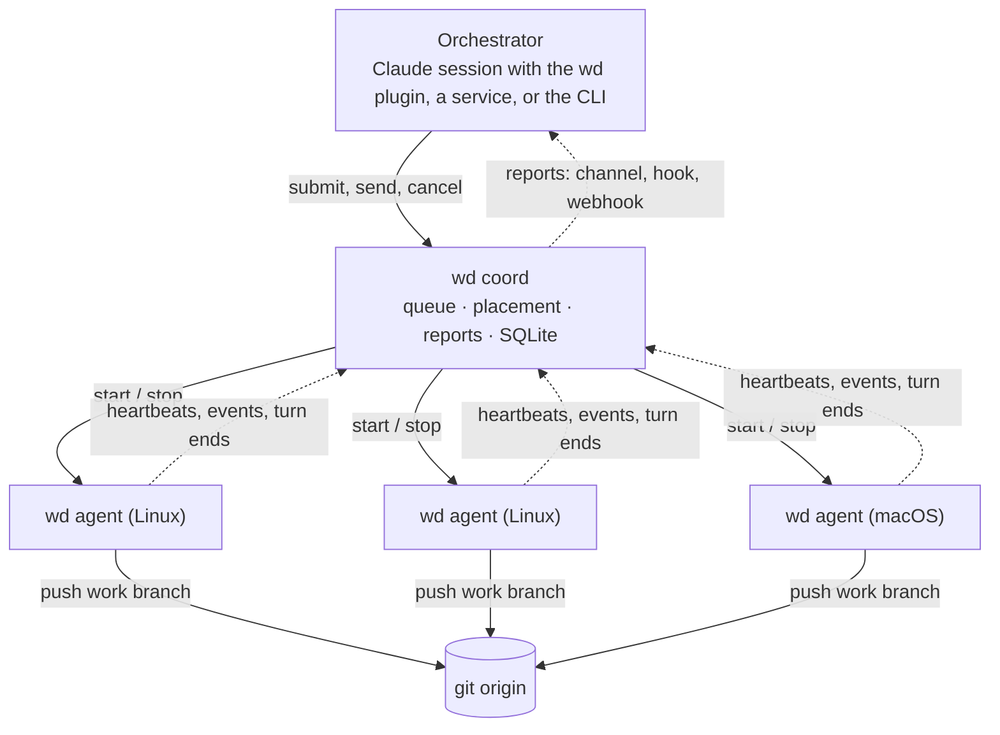

# wd: work distributor

`wd` is a queue for Claude Code threads that spreads them across your machines.

1. An agent or a person **submits** a thread: a repo, a git ref and a prompt.
2. wd holds it until a host has room, then runs it there as a headless `claude -p` session in its own git worktree.
3. When the turn ends, wd pushes the work branch and sends a **report** back to whoever submitted it.

The submitter never waits or polls. Reports arrive on their own: in a Claude Code session through the bundled plugin, or anywhere else through a webhook or the CLI.

wd only runs work and reports on it. It does not plan, review, open PRs or merge. Those belong to whatever submits the work.



Each agent runs `claude -p` turns in their own git worktrees and pushes the work branch to origin.

## How it works
- **Coordinator (`wd coord`):** one process holding the queue in SQLite.
  - Every few seconds it places queued threads. Each thread goes to the host it would run fastest on (each host's measured single-core speed and free cores), among hosts that have every label the thread requires (each host's name is one of its labels, so `requires: ["bazzite"]` pins a thread), pass the repo's doctor check, and have room for the thread's memory and CPU estimates. The estimates come from the repo's recent turns: their peak memory and their busiest minute of CPU.
  - It stores reports until they are acknowledged.
- **Agent (`wd agent`):** one per host.
  - It keeps a mirror of each repo and creates a worktree per thread.
  - It runs each turn as `claude -p --output-format stream-json`, contained in a systemd user unit with memory and time limits on Linux, or in its own process tree on macOS.
  - It streams the turn's events to the coordinator, pushes the branch with `--force-with-lease`, and heartbeats its free memory, disk and running turns.
- **Turns:**
  - A thread is a Claude session. Its first turn runs the prompt; `send` adds follow-up turns that resume the same session on the same host.
  - After each turn the thread is `idle` with its worktree kept, until it is released.
- **Failures are reported and never retried:**
  - a host that stops heartbeating (`lost`);
  - a turn with no output and no CPU for 20 min (`stalled`);
  - a launch error or an out-of-memory kill (`failed`).
  - The one exception is a turn killed by a host restart: it is resumed once on the same host.
  - Retrying anything else is the submitter's decision.

The full protocol, the placement rules and the config reference are in [docs/how-it-works.md](docs/how-it-works.md).

## Install
On the machine you run the setup commands from (the other machines get the binary from the installers below):

```sh
# Homebrew (macOS, or Linux with Homebrew)
brew tap blackveilprecision/wd https://github.com/blackveilprecision/work-distributor
brew install blackveilprecision/wd/wd

# or a release binary: wd-darwin-arm64, wd-darwin-x64, wd-linux-x64 or wd-linux-arm64
curl -fsSL -o ~/.local/bin/wd https://github.com/blackveilprecision/work-distributor/releases/latest/download/wd-darwin-arm64
chmod +x ~/.local/bin/wd

# or from source, with Bun 1.3 or newer: `wd` below is then dist/wd
git clone https://github.com/blackveilprecision/work-distributor && cd work-distributor
bun install && bun run build && export PATH="$PWD/dist:$PATH"   # from a checkout; skip with an installed wd
```

From a source checkout, the installers build each machine's binary from it. An installed `wd` copies itself to machines of its own platform and has the others download the same version from the GitHub release.

## Requirements
- On every host that runs threads:
  - `git`;
  - a logged-in `claude` CLI that works headless (`claude -p "ok"` must succeed in a clean environment);
  - a GitHub login for pushes: `gh auth login` there (the installer copies its token), or pass `--git-token-file`.
- For a host or coordinator other than the machine you are on: key-based `ssh <host>` that works without a prompt, and `scp`.
- Linux hosts need systemd (the installer enables user lingering). WSL2 works as a Linux host for the coordinator or an agent once systemd is on (`[boot]` `systemd=true` in `/etc/wsl.conf`, then `wsl --shutdown`) and the other machines can reach it: run Tailscale inside WSL, or use WSL's mirrored networking. A Windows machine that sleeps takes WSL with it, so it suits the coordinator or an agent only if it stays awake. macOS hosts run wd as a LaunchAgent in the logged-in user's session, which is what gives `claude` access to its keychain login, so someone must be logged in there.
- The machines must reach each other, for example over Tailscale. wd uses bearer tokens but no TLS, so keep it on a private network. With Tailscale running, the installers pick each machine's tailnet address by themselves.

## Setup
Run these in order, with `wd` installed as above. `<ssh-host>` is anything `ssh` accepts; the word `local` means this machine and needs no ssh.

```sh
# 1. Install the coordinator on one always-on machine.
wd coord install <ssh-host|local> [--listen <ip>:7780]

# 2. Register the repos threads may run on.
wd repo add acme/shop --doctor "bun --version"

# 3. Install an agent on every machine that should run threads (this one included, with `local`).
wd host install <ssh-host|local> [--label gpu]...
wd hosts                    # each host should say ok, or give the reason it was refused
wd hosts --repo acme/shop   # per host: eligible, or why its threads would not go there (a failing doctor, no room, ...)

# 4. Install the plugin for the Claude Code sessions that will submit work. It runs `wd mcp`, so `wd` must be on PATH in
#    those sessions (brew's, or ~/.local/bin, where the `local` installs above put it).
#    See "From a Claude Code session" for what the flag does.
claude plugin marketplace add blackveilprecision/work-distributor   # or the path of a checkout
claude plugin install wd@wd
claude --dangerously-load-development-channels plugin:wd@wd
```

What the commands do:
- **`wd coord install`** builds the binary for that machine and copies it to `~/.local/bin/wd`. If there is no `~/.config/wd/coord.json` there, it writes one with a random `callerToken`, listening on the machine's Tailscale address (or `127.0.0.1` without Tailscale) on port 7780. It installs and starts a systemd user unit `wd-coord` (Linux) or the LaunchAgent `wd.coord` (macOS). Finally it writes this machine's `~/.config/wd/client.json` (`url`, `token`) so that the other `wd` commands work. It leaves out `caller` on purpose: a fixed one would give every Claude Code session on the machine, in every project, the same inbox. It never overwrites an existing `client.json`; it prints the values instead, and warns when the file (or `WD_CLIENT_CONFIG`) points at a different coordinator, because `wd host install` registers hosts with whatever coordinator the client config names.
- **`wd repo add <owner/name>`** registers a repo with the coordinator. The URL defaults to `https://github.com/<owner/name>.git`; use `--url` for anything else, `--ref` for the default branch (`main`), `--doctor <cmd>` for a command a host must pass in the repo before it gets its threads, `--require <label>` for host labels every thread needs, and `--rust` for Rust repos (shared target dirs, sccache). `wd repo ls` and `wd repo rm <owner/name>` list and remove. Repos can also be listed in `coord.json`; those win over registered ones.
- **`wd host install`** registers the host with the coordinator (which creates its token), builds and copies the binary, writes `~/.config/wd/agent.json` on the host, and installs and starts the `wd-agent` systemd user unit or the `wd.agent` LaunchAgent. It finds `claude` on the host's login PATH (`--claude <path>` overrides). When the host has `gh` logged in, it writes the token to `~/.config/wd/git-token` there (mode 600) for pushes and says so; `--git-token-file` uses a file you already have instead. It then waits up to a minute for the host to report `ok`. `--name` sets the host name (default: the ssh host, or this machine's hostname for `local`), and `--agent-url` the URL the coordinator reaches the agent at (default `http://<tailscale ip>:7781`; a remote host without Tailscale needs `--agent-url`, because its ssh name may not resolve from the coordinator). It probes the host with the host's own login shell (bash or zsh), so Homebrew and `~/.local/bin` tools are found. On a remote host without a `~/.config/wd/client.json` it writes one with this machine's coordinator url and token (no `caller`), so sessions there can submit and read reports. Registering creates a new token for the host; the coordinator never returns an existing token.

Both installers can be run again at any time to upgrade the binary and restart the service. You rarely need to for an agent: once the coordinator runs a newer release, each agent updates itself to it (turn this off with `"autoUpdate": false` in `agent.json`). Open Claude Code sessions get the new `wd_*` tools from the coordinator without restarting. They leave an existing `coord.json` or `agent.json` alone (delete the `agent.json` to register the host again). The commands that read the coordinator's address use `~/.config/wd/client.json`, or `WD_URL`, `WD_TOKEN` and `WD_CALLER`, or the file named by `WD_CLIENT_CONFIG`.

### Submitting from another machine
Copy the `client.json` that `wd coord install` wrote (its `url` must be reachable from there) to `~/.config/wd/client.json`. The caller names the inbox: reports go to the caller that submitted the thread. By default it is `<hostname>:<project directory>`, so each project has its own inbox; set `WD_CALLER` or pass `--caller <name>` to any command to choose one. Adding `caller` to `client.json` makes every session on that machine share one inbox.

The caller token is an admin credential: whoever holds it can submit and cancel threads, register and rotate hosts and repos, and point a registered host at another URL. Copy it only to machines you trust.

### Without the installers
`wd coord` runs the coordinator and `wd agent` an agent from the files `~/.config/wd/coord.json` and `~/.config/wd/agent.json` (or `--config <file>`). The keys are in [docs/how-it-works.md](docs/how-it-works.md#configuration). Hosts and repos can be registered with the API (`PUT /hosts/<name>`, `PUT /repos/<id>`) or listed in `coord.json`.

## Try it on one machine
Everything on this machine, on `127.0.0.1` and its own data directory. It does not touch `~/.config/wd` or `~/.wd` and needs no ssh, no Tailscale and no installed service. It runs the real `claude` (a small task on `--model haiku` costs a few tenths of a cent), so it needs a logged-in one. Set `D` to any empty directory; `--port-base N` uses ports N and N+1 (default 17780, 17781).

```sh
D=~/wd-trial
bun install && bun run build && export PATH="$PWD/dist:$PATH"   # from a checkout; skip with an installed wd
wd init-local $D                          # writes coord.json, agent.json and client.json there, and prints these commands
export WD_CLIENT_CONFIG=$D/client.json    # now, before any other wd command: without it wd talks to ~/.config/wd, a real install if you have one
nohup wd coord --config $D/coord.json >$D/coord.log 2>&1 & echo $! >$D/coord.pid
nohup wd agent --config $D/agent.json >$D/agent.log 2>&1 & echo $! >$D/agent.pid
wd hosts                                  # "local" says ok after a few seconds

# A repo to work on: any git repo with at least one commit (an empty repo fails: no ref to branch from).
git init -q --bare -b main $D/origin.git
git clone -q $D/origin.git $D/seed && (cd $D/seed && git commit -q --allow-empty -m seed && git push -q origin HEAD:main)
wd repo add trial/hello --url file://$D/origin.git
wd submit trial/hello "Create hello.txt containing hi, commit it, reply done." --model haiku --tag try
wd ls                                     # the thread goes queued, running, idle (about 5 s)
wd reports                                # the report: state "idle", isError false, pushed true
git -C $D/origin.git branch               # the work branch wd/<id> is there
```
Use a shell where you do not later run the real installers, or `unset WD_CLIENT_CONFIG` first: `wd coord install` and `wd host install` also read it. In two terminals, run the two `wd coord`/`wd agent` lines without the `nohup` and the redirects.

- **The repo id** (`trial/hello`) is only a name: `wd repo add` and `wd submit` must use the same one. Without `--url` it means `https://github.com/<id>.git`.
- **Success:** `wd reports` prints JSON. A finished turn is a report with `"state":"idle"`, `"isError":false` and `"pushed":true`; `message` is claude's final text, cut at 4,000 characters, with `"truncated":true` when it was cut (`wd status <id> --full` prints the whole text). `wd reports` lists the reports not yet acknowledged; `wd ack <report id>` clears one and prints nothing. `wd status <id>` and `wd release <id>` print JSON as well.
- **Follow-ups:** `wd send <id> "..."` prints `{"queued":1}`. The turn starts on the next scheduler tick (a few seconds), and until then the thread still says `idle`. So do not poll for `idle`: wait for a new report (`wd reports --wait`), or for `turns` in `wd status` to go up.
- **Queued and not starting:** a thread stays `queued` when the host is under a placement floor: less than 15% free disk, less than the memory estimate plus 2048 MB available, or CPU in use and promised past 1.5 times its cores. `wd queue` says which, and `wd hosts` shows `cpu=` (in use or promised/cores), `mem=` (available/total) and `disk=`. On a busy machine lower them in `$D/coord.json`, for example `"floors": {"diskFreePct": 5, "memReserveMb": 512, "cpuOversub": 3}`, and restart the coordinator.
- **Stopping:** `kill $(cat $D/coord.pid $D/agent.pid)`; the agent can take a few seconds to exit. Running turns are not stopped by this.
- **Starting over:** delete `$D`. Claude Code also keeps its own session files for the worker's worktrees outside it, in `~/.claude/projects/` (directories whose name contains the `$D` path) and in its temp directory.
- Pushing to GitHub needs a token: add `"gitTokenFile": "/path/to/token"` to `agent.json`. A `file://` repo needs none.
- The agent name is `local`. Its `claude` is the first one found on PATH. `init-local` never rewrites an initialised directory.

## Usage
### CLI
`wd --help` lists the commands, and `wd <command> --help` (or `wd help <command>`) explains one with each of its options.

```sh
wd submit acme/shop "Fix the failing date test in src/date.ts and commit the fix." --model sonnet --tag date-fix
wd submit acme/shop "Redesign the order sync." --model opus --effort high   # --effort low|medium|high|xhigh|max;
                            # default: the host's settings for the model. pi threads get it as --thinking
wd ls                       # this caller's threads
wd status <id> [--full]     # --full: every turn's whole message (reports cut them at 4,000 chars)
wd send <id> "Also add a regression test."
wd reports --pending        # unacknowledged reports
wd reports --wait           # block until there is one, print it, exit 0
wd ack <report id>
wd release <id>             # remove the worktree; the branch stays pushed; no report (you asked for it)
wd cancel <id>
wd hosts [--repo <owner/name>]   # --repo: per host, why a thread of that repo would not start there
wd queue [--json]           # every caller: queued threads and why they wait, pending follow-ups, idle threads,
                            # what runs on each host and the last thing each running thread did
wd hold [--clear]           # the usage-limit hold from Claude's reset time; --clear ends it after an early reset
wd tail <id> [-n 20] [--turn n] [-f]   # a turn's recent steps: tool calls, text, results; -f follows until it ends
wd repo add <owner/name> [--url u] [--ref r] [--doctor cmd] [--require label]... [--rust]
wd repo ls
wd repo rm <owner/name>
```
Every command takes `--caller <name>` in place of `WD_CALLER`.

### Waiting for reports
`wd reports --wait` blocks until the caller has an unacknowledged report, prints the pending reports as JSON and exits 0. It does not acknowledge them, so a watcher that is killed and started again loses nothing; `wd ack` them once handled. It retries while the coordinator is unreachable and exits 1 on a bad token. A program that wakes on its children's exits can run it as one, for example with herdr's `hc`, whose children do not inherit the caller's environment:
```sh
hc run --bg --name wdwatch -- wd reports --wait --caller "$WD_CALLER"
hc wait --children any      # returns when a report arrives
```

### From a Claude Code session (plugin)
The plugin gives a session these tools:
- `wd_submit`, `wd_send`, `wd_cancel`, `wd_release`;
- `wd_status`, `wd_hosts`;
- `wd_inbox`, `wd_ack`.

It also brings a short skill. Reports reach the session in two ways:
- **Channel:** pushed into the session as `<channel source="wd">` events, which wake an idle session.
- **Hook backup:** on the next prompt, any report that wasn't acknowledged is added to the context.

Step 4 of Setup installs it and starts a session with it.
- Channels are a Claude Code research preview. A plugin outside the allowlist needs this flag, and a confirmation prompt appears on start.
- Without the flag, the tools and the hook still work; reports just arrive on your next prompt instead of waking the session.
- Headless `claude -p` sessions can't receive channel events.
- The plugin runs `wd mcp`, so `wd` must be on PATH. Otherwise, set the plugin's `WD_BIN` option with `claude plugin configure wd@wd`.

### From a service
Register a webhook for your caller:
```sh
curl -X PUT -H "authorization: Bearer $WD_TOKEN" -d '{"webhook":"http://..."}' $WD_URL/callers/orch:shop
```
Reports are then POSTed to it and acknowledged when it returns a 2xx. You can also read `GET /reports?caller=…` or the SSE stream at `/reports/stream?caller=…`.

## What a worker session gets
- Its own worktree on branch `wd/<thread>`, created from the requested ref.
- `--dangerously-skip-permissions`, with only user settings and no MCP servers.
- A fixed environment with GitHub credentials removed.

Only the agent pushes, after the turn. This keeps credentials out of the worker's environment, but it is not a sandbox: the worker runs as the host user.

## Herdr panel
[contrib/herdr](contrib/herdr/README.md) has a panel for the [Herdr](https://herdr.dev) app that shows `wd queue` live: what waits and why, what each host is running and doing, and what is idle.

## Development
See [CONTRIBUTING.md](CONTRIBUTING.md) and [AGENTS.md](AGENTS.md).

## License
[MIT](LICENSE).
